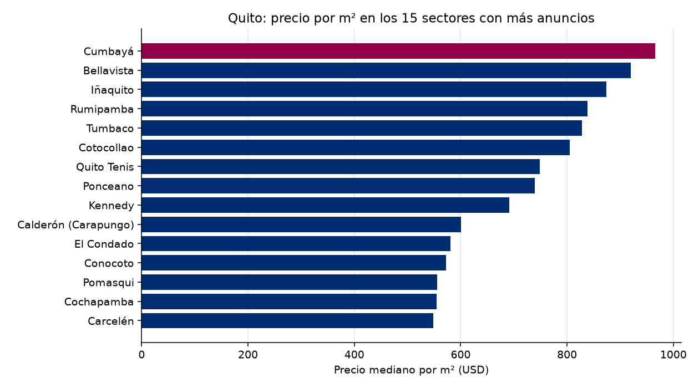

# Observatorio de Referencia · Mercado inmobiliario de Quito
Reporte del 2026-10-12

## Lo más importante
- Anuncios analizados: **1071**
- Precio mediano por m²: **USD 642** (-0.11 % contra la corrida anterior)
- Sin alerta. (umbral: 5.0 %)

## Calidad de los datos
- Anuncios recibidos: 2360; quedaron 1071 tras la limpieza.
- Descartados por no es venta: 406
- Descartados por no es vivienda: 689
- Descartados por no esta activo: 117
- Descartados por sin precio: 2
- Descartados por area imposible: 9
- Descartados por duplicado con otro id: 6
- Descartados por precio m2 imposible: 1
- Descartados por precio m2 extremo: 59
- Precios corregidos por punto de miles: 3

## Por sector (los 20 con más anuncios)
| Sector | Anuncios | Mediana USD/m² | Precio mediano USD |
|---|---|---|---|
| Conocoto | 56 | 572 | 105,000 |
| Iñaquito | 37 | 874 | 155,000 |
| Tumbaco | 35 | 828 | 181,500 |
| Quito Tenis | 30 | 749 | 204,250 |
| Calderón (Carapungo) | 30 | 601 | 74,962 |
| Cumbayá | 27 | 966 | 281,900 |
| Rumipamba | 27 | 838 | 149,000 |
| Bellavista | 25 | 920 | 249,000 |
| El Condado | 24 | 581 | 144,000 |
| Cotocollao | 23 | 805 | 72,080 |
| Carcelén | 20 | 548 | 87,500 |
| Ponceano | 19 | 739 | 86,000 |
| Cochapamba | 18 | 555 | 122,500 |
| Pomasqui | 16 | 556 | 112,500 |
| Kennedy | 13 | 691 | 108,000 |
| San Antonio | 12 | 534 | 84,000 |
| San Isidro Del Inca | 11 | 748 | 93,000 |
| Alangasí | 11 | 515 | 144,000 |
| Belisario Quevedo | 10 | 867 | 103,500 |
| Union Nacional | 10 | 740 | 125,000 |

## El entorno económico del Ecuador
- Inflación anual (Banco Mundial): 0.7% (2025)
- Crecimiento del PIB (Banco Mundial): 3.7% (2025)
- Crecimiento del PIB (FMI): 3.7% (2025)
- Crédito al sector privado (% del PIB, Banco Mundial): 58.9% (2025)

## De dónde salen los datos
- Anuncios: remax_en_vivo
- Macroeconomía: Banco Mundial y FMI
