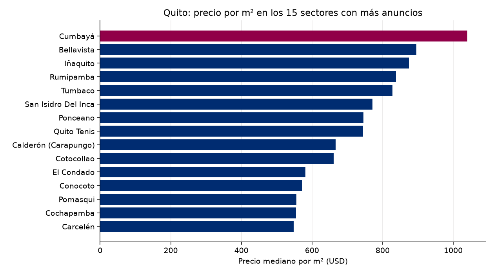

# Observatorio de Referencia · Mercado inmobiliario de Quito
Reporte del 2026-10-15

## Lo más importante
- Anuncios analizados: **1073**
- Precio mediano por m²: **USD 643** (-0.19 % contra la corrida anterior)
- Sin alerta. (umbral: 5.0 %)

## Calidad de los datos
- Anuncios recibidos: 2378; quedaron 1073 tras la limpieza.
- Descartados por no es venta: 403
- Descartados por no es vivienda: 700
- Descartados por no esta activo: 125
- Descartados por sin precio: 2
- Descartados por area imposible: 8
- Descartados por duplicado con otro id: 7
- Descartados por precio m2 imposible: 1
- Descartados por precio m2 extremo: 59
- Precios corregidos por punto de miles: 3

## Por sector (los 20 con más anuncios)
| Sector | Anuncios | Mediana USD/m² | Precio mediano USD |
|---|---|---|---|
| Conocoto | 56 | 572 | 105,000 |
| Iñaquito | 37 | 874 | 155,000 |
| Tumbaco | 35 | 828 | 181,500 |
| Calderón (Carapungo) | 35 | 667 | 75,465 |
| Quito Tenis | 31 | 745 | 199,500 |
| Cumbayá | 28 | 1,040 | 265,950 |
| Rumipamba | 27 | 838 | 149,000 |
| Bellavista | 25 | 895 | 249,000 |
| El Condado | 24 | 581 | 144,000 |
| Cotocollao | 21 | 661 | 72,742 |
| Carcelén | 20 | 548 | 87,500 |
| Ponceano | 18 | 746 | 88,500 |
| Cochapamba | 18 | 555 | 122,500 |
| Pomasqui | 16 | 556 | 112,500 |
| San Isidro Del Inca | 14 | 771 | 102,950 |
| Kennedy | 13 | 691 | 108,000 |
| San Antonio | 12 | 534 | 81,000 |
| Jipijapa | 11 | 888 | 200,000 |
| Alangasí | 11 | 515 | 144,000 |
| Quitumbe | 11 | 503 | 63,000 |

## El entorno económico del Ecuador
- Inflación anual (Banco Mundial): 0.7% (2025)
- Crecimiento del PIB (Banco Mundial): 3.7% (2025)
- Crecimiento del PIB (FMI): 3.7% (2025)
- Crédito al sector privado (% del PIB, Banco Mundial): 58.9% (2025)

## De dónde salen los datos
- Anuncios: remax_en_vivo
- Macroeconomía: Banco Mundial y FMI
