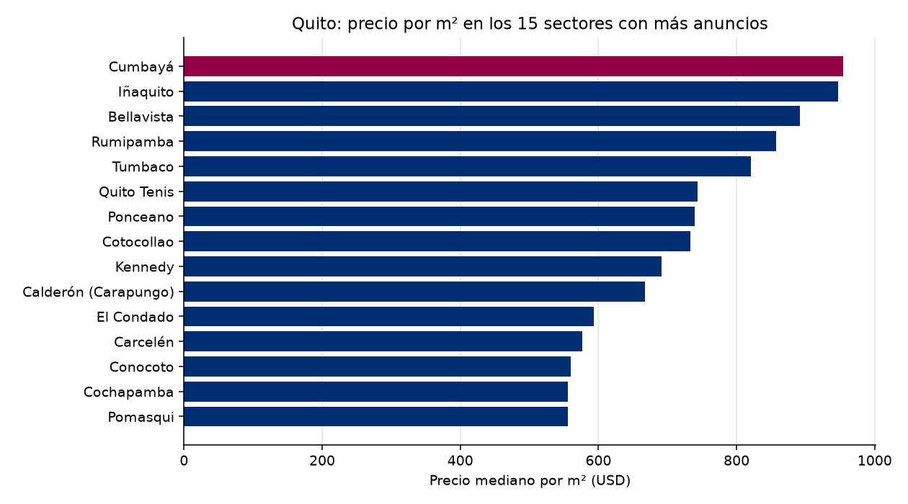

# Observatorio de Referencia · Mercado inmobiliario de Quito
Reporte del 2026-10-23

## Lo más importante
- Anuncios analizados: **1071**
- Precio mediano por m²: **USD 643** (+0.08 % contra la corrida anterior)
- Sin alerta. (umbral: 5.0 %)

## Calidad de los datos
- Anuncios recibidos: 2365; quedaron 1071 tras la limpieza.
- Descartados por no es venta: 392
- Descartados por no es vivienda: 697
- Descartados por no esta activo: 126
- Descartados por sin precio: 2
- Descartados por area imposible: 8
- Descartados por duplicado con otro id: 4
- Descartados por precio m2 imposible: 1
- Descartados por precio m2 extremo: 64
- Precios corregidos por punto de miles: 3

## Por sector (los 20 con más anuncios)
| Sector | Anuncios | Mediana USD/m² | Precio mediano USD |
|---|---|---|---|
| Conocoto | 55 | 560 | 106,000 |
| Iñaquito | 37 | 947 | 155,000 |
| Calderón (Carapungo) | 35 | 667 | 75,465 |
| Tumbaco | 34 | 821 | 183,250 |
| Quito Tenis | 32 | 743 | 198,750 |
| Cumbayá | 30 | 954 | 245,000 |
| Rumipamba | 25 | 857 | 135,000 |
| Bellavista | 24 | 892 | 249,500 |
| El Condado | 24 | 593 | 160,000 |
| Cotocollao | 20 | 733 | 72,411 |
| Carcelén | 19 | 577 | 89,000 |
| Cochapamba | 19 | 556 | 120,000 |
| Ponceano | 17 | 739 | 85,000 |
| Kennedy | 15 | 691 | 110,000 |
| Pomasqui | 14 | 556 | 112,500 |
| Alangasí | 14 | 533 | 227,500 |
| San Isidro Del Inca | 13 | 795 | 112,900 |
| San Antonio | 12 | 505 | 91,500 |
| Quitumbe | 12 | 494 | 56,000 |
| Turubamba | 12 | 443 | 48,500 |

## El entorno económico del Ecuador
- Inflación anual (Banco Mundial): 0.7% (2025)
- Crecimiento del PIB (Banco Mundial): 3.7% (2025)
- Crecimiento del PIB (FMI): 3.7% (2025)
- Crédito al sector privado (% del PIB, Banco Mundial): 58.9% (2025)

## De dónde salen los datos
- Anuncios: remax_en_vivo
- Macroeconomía: Banco Mundial y FMI
