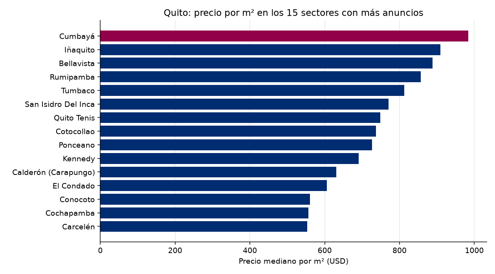

# Observatorio de Referencia · Mercado inmobiliario de Quito
Reporte del 2026-10-29

## Lo más importante
- Anuncios analizados: **1073**
- Precio mediano por m²: **USD 643** (+0.00 % contra la corrida anterior)
- Sin alerta. (umbral: 5.0 %)

## Calidad de los datos
- Anuncios recibidos: 2366; quedaron 1073 tras la limpieza.
- Descartados por no es venta: 395
- Descartados por no es vivienda: 699
- Descartados por no esta activo: 121
- Descartados por sin precio: 2
- Descartados por area imposible: 8
- Descartados por duplicado con otro id: 4
- Descartados por precio m2 extremo: 64
- Precios corregidos por punto de miles: 3

## Por sector (los 20 con más anuncios)
| Sector | Anuncios | Mediana USD/m² | Precio mediano USD |
|---|---|---|---|
| Conocoto | 55 | 560 | 105,000 |
| Calderón (Carapungo) | 37 | 631 | 75,000 |
| Iñaquito | 35 | 909 | 148,000 |
| Tumbaco | 33 | 813 | 185,000 |
| Quito Tenis | 32 | 749 | 198,750 |
| Rumipamba | 27 | 857 | 135,000 |
| Cumbayá | 26 | 984 | 265,950 |
| El Condado | 26 | 606 | 145,000 |
| Bellavista | 25 | 888 | 250,000 |
| Carcelén | 23 | 553 | 86,000 |
| Cotocollao | 22 | 737 | 72,832 |
| Cochapamba | 19 | 556 | 120,000 |
| Ponceano | 15 | 726 | 92,000 |
| Kennedy | 15 | 691 | 110,000 |
| San Isidro Del Inca | 14 | 771 | 113,950 |
| Pomasqui | 14 | 556 | 112,500 |
| Alangasí | 13 | 529 | 240,000 |
| San Antonio | 12 | 505 | 91,500 |
| Quitumbe | 12 | 494 | 56,000 |
| Turubamba | 12 | 443 | 47,500 |

## El entorno económico del Ecuador
- Inflación anual (Banco Mundial): 0.7% (2025)
- Crecimiento del PIB (Banco Mundial): 3.7% (2025)
- Crecimiento del PIB (FMI): 3.7% (2025)
- Crédito al sector privado (% del PIB, Banco Mundial): 58.9% (2025)

## De dónde salen los datos
- Anuncios: remax_en_vivo
- Macroeconomía: Banco Mundial y FMI
