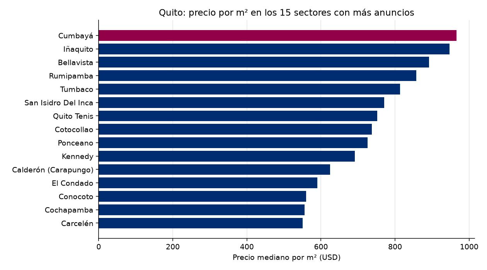

# Observatorio de Referencia · Mercado inmobiliario de Quito
Reporte del 2026-10-31

## Lo más importante
- Anuncios analizados: **1071**
- Precio mediano por m²: **USD 641** (+0.15 % contra la corrida anterior)
- Sin alerta. (umbral: 5.0 %)

## Calidad de los datos
- Anuncios recibidos: 2352; quedaron 1071 tras la limpieza.
- Descartados por no es venta: 392
- Descartados por no es vivienda: 692
- Descartados por no esta activo: 119
- Descartados por sin precio: 2
- Descartados por area imposible: 8
- Descartados por duplicado con otro id: 4
- Descartados por precio m2 extremo: 64
- Precios corregidos por punto de miles: 3

## Por sector (los 20 con más anuncios)
| Sector | Anuncios | Mediana USD/m² | Precio mediano USD |
|---|---|---|---|
| Conocoto | 55 | 560 | 105,000 |
| Calderón (Carapungo) | 38 | 625 | 75,232 |
| Iñaquito | 33 | 947 | 140,000 |
| Tumbaco | 33 | 813 | 185,000 |
| Quito Tenis | 31 | 752 | 199,500 |
| Rumipamba | 27 | 857 | 135,000 |
| Bellavista | 26 | 892 | 250,000 |
| Cumbayá | 25 | 966 | 250,000 |
| El Condado | 23 | 590 | 145,000 |
| Cotocollao | 22 | 737 | 72,832 |
| Carcelén | 22 | 550 | 82,500 |
| Cochapamba | 19 | 556 | 120,000 |
| Ponceano | 15 | 726 | 92,000 |
| Kennedy | 15 | 691 | 110,000 |
| San Isidro Del Inca | 14 | 771 | 113,950 |
| Pomasqui | 14 | 556 | 112,500 |
| Alangasí | 12 | 522 | 255,000 |
| San Antonio | 12 | 505 | 91,500 |
| Quitumbe | 12 | 494 | 56,000 |
| Turubamba | 12 | 443 | 47,500 |

## El entorno económico del Ecuador
- Inflación anual (Banco Mundial): 0.7% (2025)
- Crecimiento del PIB (Banco Mundial): 3.7% (2025)
- Crecimiento del PIB (FMI): 3.7% (2025)
- Crédito al sector privado (% del PIB, Banco Mundial): 58.9% (2025)

## De dónde salen los datos
- Anuncios: remax_en_vivo
- Macroeconomía: Banco Mundial y FMI
