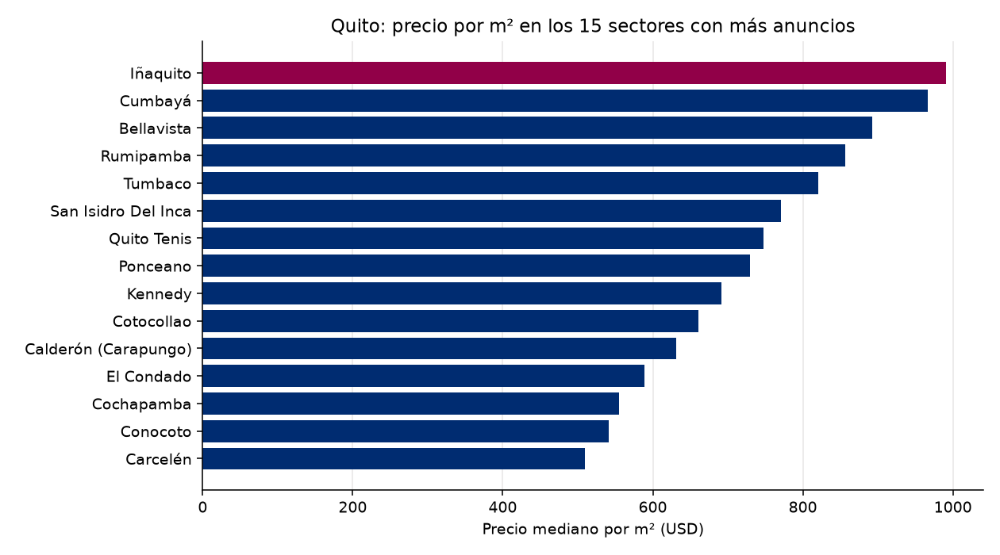

# Observatorio de Referencia · Mercado inmobiliario de Quito
Reporte del 2026-11-12

## Lo más importante
- Anuncios analizados: **1063**
- Precio mediano por m²: **USD 643** (-0.28 % contra la corrida anterior)
- Sin alerta. (umbral: 5.0 %)

## Calidad de los datos
- Anuncios recibidos: 2348; quedaron 1063 tras la limpieza.
- Descartados por no es venta: 401
- Descartados por no es vivienda: 692
- Descartados por no esta activo: 116
- Descartados por sin precio: 2
- Descartados por area imposible: 8
- Descartados por duplicado con otro id: 7
- Descartados por precio m2 imposible: 2
- Descartados por precio m2 extremo: 57
- Precios corregidos por punto de miles: 3

## Por sector (los 20 con más anuncios)
| Sector | Anuncios | Mediana USD/m² | Precio mediano USD |
|---|---|---|---|
| Conocoto | 52 | 541 | 105,000 |
| Calderón (Carapungo) | 37 | 631 | 74,924 |
| Tumbaco | 34 | 821 | 183,250 |
| Iñaquito | 32 | 991 | 140,000 |
| Quito Tenis | 30 | 748 | 204,250 |
| Rumipamba | 27 | 857 | 135,000 |
| Bellavista | 26 | 892 | 250,000 |
| Cumbayá | 25 | 966 | 290,000 |
| Cotocollao | 23 | 661 | 72,922 |
| El Condado | 21 | 589 | 145,000 |
| Carcelén | 20 | 510 | 84,000 |
| Cochapamba | 18 | 555 | 122,500 |
| San Isidro Del Inca | 16 | 771 | 103,950 |
| Ponceano | 16 | 730 | 101,000 |
| Kennedy | 15 | 691 | 110,000 |
| Pomasqui | 15 | 570 | 115,000 |
| Alangasí | 12 | 533 | 255,000 |
| Quitumbe | 12 | 494 | 56,000 |
| San Antonio | 12 | 478 | 81,000 |
| Turubamba | 12 | 443 | 47,500 |

## El entorno económico del Ecuador
- Inflación anual (Banco Mundial): 0.7% (2025)
- Crecimiento del PIB (Banco Mundial): 3.7% (2025)
- Crecimiento del PIB (FMI): 3.7% (2025)
- Crédito al sector privado (% del PIB, Banco Mundial): 58.9% (2025)

## De dónde salen los datos
- Anuncios: remax_en_vivo
- Macroeconomía: Banco Mundial y FMI
