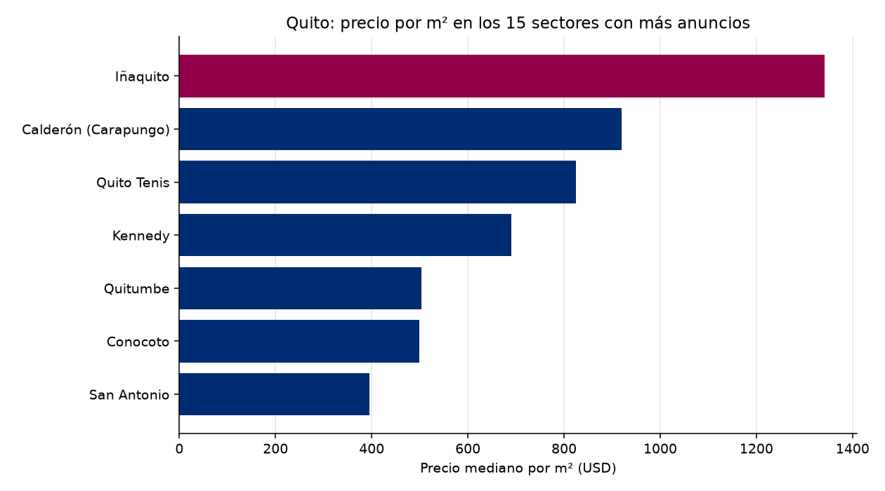

# Observatorio de Referencia · Mercado inmobiliario de Quito
Reporte del 2026-11-14

## Lo más importante
- Anuncios analizados: **106**
- Precio mediano por m²: **USD 605** (primera corrida: aún no hay con qué comparar)
- Sin alerta. (umbral: 5.0 %)

> Esta corrida usó datos de respaldo: no se guardó en el histórico ni se calculó alerta.

## Calidad de los datos
- Anuncios recibidos: 170; quedaron 106 tras la limpieza.
- Descartados por no es venta: 30
- Descartados por no es vivienda: 26
- Descartados por precio m2 imposible: 1
- Descartados por precio m2 extremo: 7
- Precios corregidos por punto de miles: 3

## Por sector (los 20 con más anuncios)
| Sector | Anuncios | Mediana USD/m² | Precio mediano USD |
|---|---|---|---|
| Calderón (Carapungo) | 10 | 920 | 74,902 |
| Quito Tenis | 6 | 825 | 182,250 |
| Kennedy | 5 | 691 | 132,000 |
| Iñaquito | 4 | 1,342 | 162,500 |
| Quitumbe | 3 | 503 | 63,000 |
| Conocoto | 3 | 499 | 100,000 |
| San Antonio | 3 | 395 | 110,000 |

## El entorno económico del Ecuador
- Inflación anual (Banco Mundial): 0.7% (2025)
- Crecimiento del PIB (Banco Mundial): 3.7% (2025)
- Crecimiento del PIB (FMI): 3.7% (2025)
- Crédito al sector privado (% del PIB, Banco Mundial): 58.9% (2025)

## De dónde salen los datos
- Anuncios: respaldo_remax_real
- Macroeconomía: Banco Mundial y FMI
